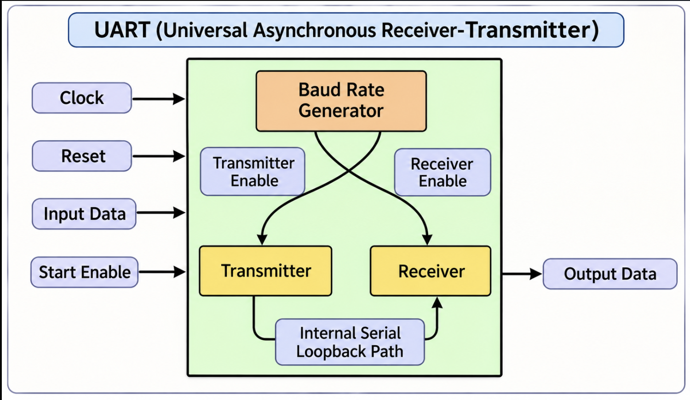
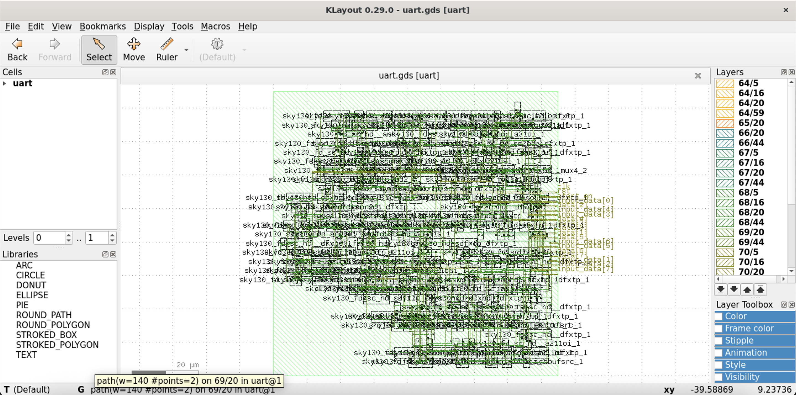
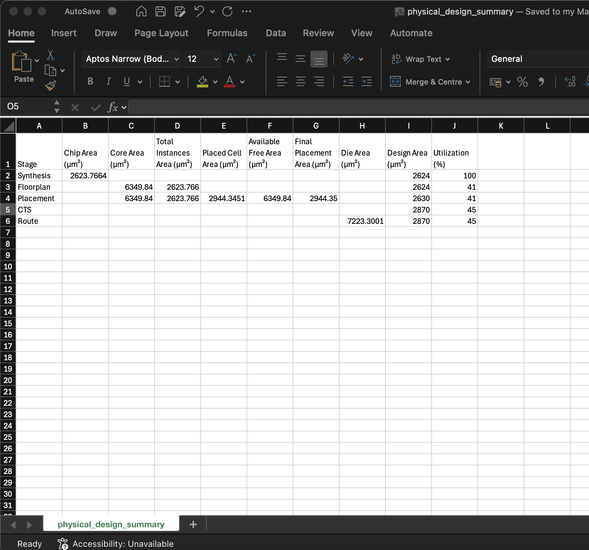
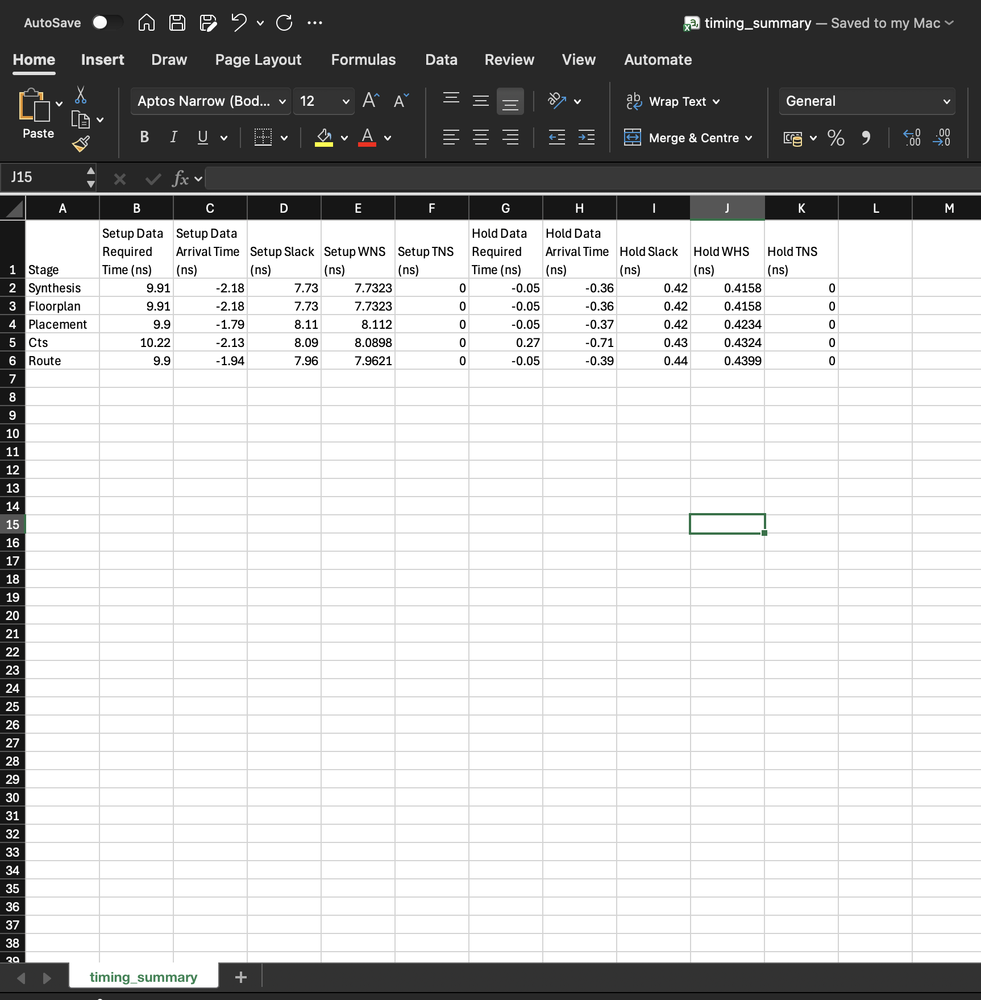

<h1 align = "center">UART RTL-to-GDSII PHYSICAL DESIGN AND AUTOMATION </h1>

## 1. OVERVIEW
This project demonstrates the Physical Design implementation of UART (Universal Asynchronous Receiver Transmitter).

The project covers the major stages of the VLSI Physical Design flow, starting with **Logic Synthesis** and progressing through **Floorplanning**, **Placement**, **Clock Tree Synthesis (CTS)**, **Routing**, and **GDSII** generation.

The implementation uses **Yosys** for logic synthesis and **OpenROAD** for physical design. The **Sky130A PDK** provides the technology files, standard-cell libraries, and physical design information required for implementation. Additionally, **Python** is used to automate the extraction and analysis of physical design and timing metrics from tool-generated logs and reports.

## 2. TOOLS AND TECHNOLOGIES
| Tool / Technology | Purpose |
|----- | ------|
| Verilog HDL | RTL design and hardware description |
| Yosys | Logic synthesis |
| OpenROAD | Physical design implementation |
| OpenSTA | Static Timing Analysis |
| Sky130A PDK | Process Design Kit and technology libraries |
| TCL | Physical design flow scripting |
| Python | Physical design and timing report extraction and automation |
| Makefile | Flow execution and automation |
| KLayout | Converts the routed DEF and standard-cell GDS files into GDSII format |
  
## 3. DESIGN DESCRIPTION
The UART design consists of three major functional blocks:
- **Baud Rate Generator:** Generates the timing signal required to maintain the baud rate for serial data transmission and reception
- **Transmitter:** Converts parallel input data into serial data and transmits it
- **Receiver:** Receives serial data and reconstructs the corresponding parallel data
### UART Block Diagram


## 4. PROJECT FILES AND IMPLEMENTATION DETAILS
- ### UART Verilog HDL Code Files :
    + The UART design consists of four Verilog modules: **Baud Rate Generator, Transmitter, Receiver, and UART Top**
    + These Verilog source files serve as the input RTL files for logic synthesis
- ### Constraint File :
    + The **Synopsys Design Constraints** (SDC) file specifies the timing constraints required for the physical design flow
    + A clock constraint with a period of **10 ns** is defined for the design
- ### TCL Scripts :
    + TCL scripts are developed to execute and automate the different stages of the physical design flow
    + The scripts read the required technology LEF, standard-cell LEF, and Liberty files and initialize the necessary design configurations and directories
    + Each script executes the corresponding physical design stage and generates the required output files and reports
- ### Python Script :
    + A Python script is developed to extract the required physical design and timing metrics from tool-generated logs and reports
    + The extracted metrics are organized into structured **CSV files** for easier analysis and comparison across different physical design stages
- ### Make file :
    + The Makefile is used to organize and automate the execution of the complete physical design flow
    + It defines the commands and dependencies required to execute individual stages and the complete flow
    + The entire flow can be executed using the `make` command
    + Individual stages can be executed using their corresponding Makefile targets, such as `make synth`, `make floorplan`, or `make placement`

## 5. PHYSICAL DESIGN AND AUTOMATION FLOW DESCRIPTION
- ### Synthesis :
    + **Tool:** Yosys
    + Reads the Verilog RTL source files
    + Performs logic synthesis and technology mapping
    + Maps the synthesized logic to standard cells using the target Liberty library
    + Generates the synthesized gate-level netlist
    + **Output:** Synthesized Verilog netlist

- ### Floorplanning :
    + **Tool:** OpenROAD
    + Reads the synthesized netlist, technology LEF, standard-cell LEF, and Liberty library
    + Defines the initial floorplan based on the specified core utilization and aspect ratio
    + Generates routing tracks according to the technology specifications
    + Performs input/output pin placement
    + **Output:** - Floorplan ODB and Floorplan DEF

- ### Placement :
    + **Tool:** OpenROAD
    + Performs global placement and detailed placement
    + Optimizes the placement to improve timing and design quality
    + Estimates interconnect parasitics based on placement information
    + **Output:** - Placement ODB and Placement DEF

- ### Clock Tree Synthesis (CTS) :
    + **Tool:** OpenROAD
    + Builds the clock distribution network
    + Inserts clock buffers and performs clock tree optimization
    + **Output:** - CTS ODB and CTS DEF

- ### Routing :
    + **Tool:** OpenROAD
    + Performs global routing and detailed routing
    + Establishes physical interconnections between standard cells
    + Performs timing analysis using estimated parasitics
    + **Output:** - Routed ODB, Routed DEF and Final routed Verilog netlist

- ### GDSII Generation :
    + **Tool:** KLayout
    + Converts the routed DEF and standard-cell GDS files into GDSII format
    + Generates the final physical layout representation of the design
    + **Output:** - GDSII layout file
    
- ### Report Generation Using Python :
    + A Python-based automation script is developed to automatically extract physical design and timing metrics from the generated tool logs and reports
    + Instead of manually inspecting individual log files, the script collects the required metrics and generates structured CSV reports
    + The script reads the generated synthesis and physical design logs
    + Regular expressions are used to extract area and utilization metrics from the generated reports and logs
    + Timing reports are processed to extract setup and hold timing information
    + The following **Physical Design Metrics** are extracted:
        * Chip Area
        * Core Area 
        * Total Instances Area 
        * Placed Cell Area
        * Available Free Area 
        * Final Placement Area 
        * Die Area 
        * Design Area
        * Utilization
    + The following **Timing Metrics** are extracted:
        * Setup Data Required Time
        * Setup Data Arrival Time
        * Setup Slack
        * Setup WNS
        * Setup TNS
        * Hold Data Required Time
        * Hold Data Arrival Time
        * Hold Slack
        * Hold WHS
        * Hold TNS
    + The Python script generates the following reports:
        * `physical_design_summary.csv` - Contains the extracted area and utilization metrics across the physical design stages
        * `timing_summary.csv`-  Contains the setup and hold timing metrics across the physical design stages
    
    

## 6. STATIC TIMING ANALYSIS (STA)

Static Timing Analysis is performed at different stages of the physical design flow to evaluate the timing characteristics of the design.
The project analyzes the following timing parameters:
| Timing Parameter | Description |
| ----- | ----- |
| Setup Time |  Minimum time data must be stable before the active clock edge |
| Hold Time | Minimum time data must remain stable after the active clock edge |
| Setup Slack | Timing margin between required and actual data arrival times for setup analysis |
| Hold Slack | Timing margin for hold analysis |
| WNS | Worst Negative Slack |
| TNS | Total Negative Slack |
| WHS | Worst Hold Slack |

## 7. REPOSITORY STRUCTURE:
``` text
UART_Physical_Design/
├── src/
     ├── uart_top.v
     ├── baudrategenerator.v
     ├── receiver.v
     └── transmitter.v
├── constraint/
    └── uart.sdc
├── scripts/
    ├── synthesis.tcl
    ├── floorplan.tcl
    ├── placement.tcl
    ├── cts.tcl
    └── routing.tcl
├── python_script/
    └── physical_design_automation_script.py
├── automation_report/
    ├── physical_design_summary.csv
    └── timing_summary.csv
├── Makefile
├── README.md
└── Images/ 
```

## 8. KEY LEARNINGS
-   Understanding the complete RTL-to-GDSII implementation flow
-   Performing logic synthesis and technology mapping
-   Understanding floorplanning, placement, and clock tree synthesis
-   Understanding global and detailed routing
-   Performing setup and hold timing analysis
-   Interpreting area, utilization, and timing reports
-   Writing TCL scripts to automate OpenROAD operations
-   Developing Python scripts for physical design report extraction
-   Integrating multiple EDA tools using a Makefile-based workflow
---